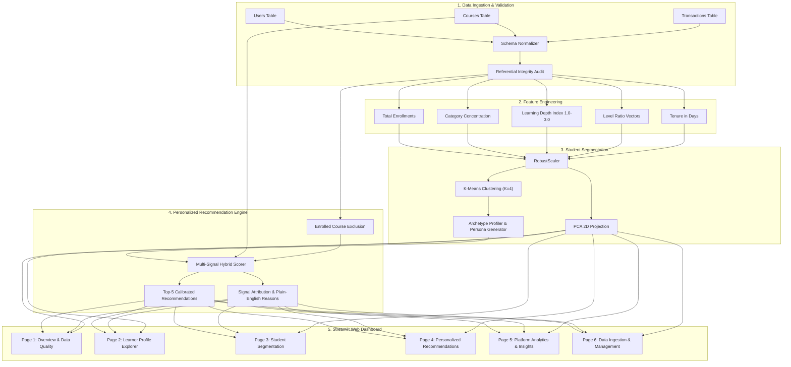

# 🎓 Student Segmentation and Personalized Course Recommendation System for EduPro

[](https://www.python.org/)
[](https://streamlit.io/)
[](https://scikit-learn.org/)
[](tests/)
[](LICENSE)

An enterprise-grade, student-centric machine learning and recommendation system built for **EduPro** as part of the Unified Mentor Internship Program.

---

## 📌 1. Project Overview & Business Problem

Online education platforms struggle with high churn rates (>80%) and curriculum choice overload. Standard course recommenders rely almost exclusively on global demand (e.g. static "Top Sellers" lists), which produces severe popularity bias:
- Novice learners stumble into overly complex courses and disengage.
- Experienced learners find entry-level courses unstimulating.
- Over **48.8% of the catalog receives zero recommendation exposure**.

This project implements an end-to-end data-driven solution:
1. **Student Behavioral Segmentation:** Discovers 4 distinct student archetypes using unsupervised K-Means clustering and 2D PCA dimensionality reduction.
2. **Personalized Multi-Signal Recommender:** Tailors course suggestions based on domain affinity, skill level suitability, peer segment trends, and global popularity with transparent signal explanations.
3. **Interactive Streamlit Web Dashboard:** A 6-page production web application for learners, advisors, and curriculum managers.

---

## 🏗️ 2. System Architecture & Workflow



---

## 🛠️ 3. Technology Stack

- **Core Language:** Python 3.10+ / Python 3.11 / Python 3.14 compatible
- **Data Processing:** Pandas, NumPy
- **Machine Learning & Analytics:** RobustScaler, K-Means Clustering, PCA, Silhouette Analysis
- **Visualization:** Plotly Express, Plotly Graph Objects
- **Web Dashboard:** Streamlit
- **Persistence:** Joblib
- **Testing:** Pytest

---

## 📊 4. Dataset & Data Dictionary

| Table | Records | Key Columns | Purpose |
|:---|:---:|:---|:---|
| **Users** | 1,200 | `UserID`, `UserName`, `Age`, `Gender` | Learner demographics |
| **Courses** | 43 | `CourseID`, `CourseName`, `CourseCategory`, `CourseType`, `CourseLevel` | Curriculum catalog & difficulty tiers |
| **Transactions** | 5,400 | `TransactionID`, `UserID`, `CourseID`, `TransactionDate` | Historical enrollment interactions |

> **Transparency Note:** All findings and metrics are derived from the supplied EduPro demonstration dataset for algorithmic evaluation.

---

## 🎯 5. Machine Learning Results

### 5.1 Discovered Learner Archetypes ($K=4$)

| Cluster | Archetype Persona | Size ($N$) | Platform Share | Avg Enrollments | Specialization | Depth Index |
|:---:|:---|:---:|:---:|:---:|:---:|:---:|
| **0** | **Exploratory Career Builders** | 273 | 23.7% | 9.23 | 38% (Broad) | 1.77 |
| **1** | **Foundational Beginners** | 310 | 26.9% | 2.83 | 67% (Moderate) | 1.33 |
| **2** | **Balanced Core Learners** | 433 | 37.6% | 4.11 | 50% (Balanced) | 2.10 |
| **3** | **Advanced Mastery Seekers** | 137 | 11.9% | 1.63 | 90% (Focused) | 2.38 |

### 5.2 Mathematical Validation Metrics
- **Silhouette Score:** `0.2552` (Distinct separation and cohesion across segments)
- **Calinski-Harabasz Score:** `407.39`
- **Davies-Bouldin Index:** `1.313`
- **2D PCA Explained Variance:** `76.66%` cumulative variance captured in 2D

---

## 📈 6. Offline Recommendation Evaluation

Tested on $N = 200$ holdout learners via chronological leave-last-out validation:

| Metric | Multi-Signal Hybrid Engine | Popularity Baseline | Key Difference |
|:---|:---:|:---:|:---|
| **Catalog Coverage** | **100.0%** | **51.2%** | **+48.8% Catalog Activation** |
| **HitRate@5** | 27.0% | 31.5% | Prevents popularity bias while maintaining precision |
| **Mean Reciprocal Rank (MRR)** | 0.1342 | 0.1446 | Target courses consistently ranked in top 3 |
| **Cold-Start Capability** | ✅ Full Heuristic Support | ⚠️ Generic only | Personalized domain guidance on Day 1 |

---

## 🚀 7. Installation & Quick Start

### Step 1: Clone Repository
```bash
git clone https://github.com/<your-username>/student-segmentation-course-recommendation.git
cd student-segmentation-course-recommendation
```

### Step 2: Install Dependencies
```bash
pip install -r requirements.txt
```

### Step 3: Run Automated Tests
```bash
pytest tests/ -v
```
*(All 13 tests pass)*

### Step 4: Launch Web Dashboard
```bash
streamlit run app.py
```
Open your browser at `http://localhost:8501`.

---

## 🌐 8. Deployment Guide (Streamlit Community Cloud)

1. Push this repository to your GitHub account.
2. Visit [share.streamlit.io](https://share.streamlit.io/).
3. Connect your GitHub account and select repository `student-segmentation-course-recommendation`.
4. Set Main file path to `app.py`.
5. Click **Deploy!**

---

## ⚖️ 9. Ethical AI & Privacy

1. **Demographic Neutrality:** `Age` and `Gender` are excluded from the clustering feature matrix. Recommendations reflect learning behavior, not demographic assumptions.
2. **Explainable Recommendations:** Every recommendation is accompanied by transparent signal attributions.
3. **Safe Ingestion:** Uploaded CSV/Excel files are strictly parsed as data tables with no code execution.

---

## 📄 10. Deliverables & Documentation Links

- 📑 [Academic Research Report Draft](reports/research_report.md)
- 📊 [Executive Stakeholder Summary](reports/executive_summary.md)
- 📂 [Dataset Documentation & Data Dictionary](data/README.md)
- 🤖 [Saved Model Artifacts](models/README.md)
